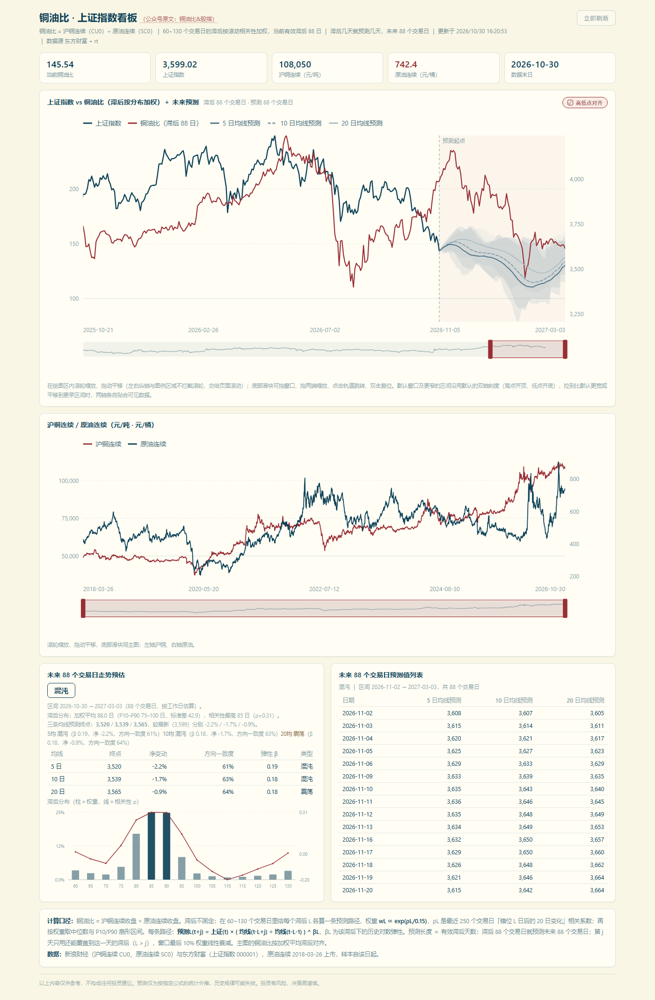

# 铜油比 · 上证指数看板

> 把「铜油比」这条 A 股领先指标做成 DSH 里的一页看板：沪铜连续 ÷ 原油连续，按 60~130 个交易日的**滞后分布**对齐上证，再外推未来同样长度的交易日。



<sub>上图是实际面板：近一年上证（深色）与滞后对齐后的铜油比（红色）、三条均线预测与 P10–P90 区间，右侧阴影区为预测段。</sub>

---

## 装上之后

1. 左侧边栏多一个**铜油比**图标，点开是一整页看板；
2. 对话里直接问「现在铜油比多少、上证后面怎么走」，Agent 会调用 `copper_oil_snapshot` 返回读数，不用开面板。

面板从上到下：**读数卡 → 主图 → 沪铜/原油 → 走势预估 + 滞后分布 → 逐日预测列表 → 口径说明**。

---

## 和常见画法有什么不同

| 常见做法 | 这里的做法 |
|---|---|
| 固定「滞后 3 个月」 | 60~130 日各算一条路径，按最近 250 日的相关性加权，有效滞后**每天重算**（近一年实测在 85~105 日之间漂移）|
| 只画一条预测线 | 5/10/20 三条路径，各自带 **P10–P90** 区间 |
| 预测长度随意定 | **预测长度 = 有效滞后**：滞后 88 日就预测 88 个交易日 |
| 水平值看起来贴合就完事 | 用「错位 L 日后的 20 日变化」相关性定权，避免两条趋势线的伪相关 |

---

## 安装

需要 DSH 桌面端（`engines.dsh >= 0.2.1-rc.3`），无需 Python、无需 `npm install`。

**方式一：克隆仓库**

```bash
git clone <仓库地址>    # 仓库页 Code 按钮里可复制
```

**方式二：下载 ZIP**，解压到任意目录（例如 `D:\dsh-plugins\copper-oil-plugin`）。

然后在 DSH 的任意会话里对助手说：

> 安装本地插件，路径 `D:\dsh-plugins\copper-oil-plugin`

助手会调用 `plugin_manager`（`action: install_bundle`，`target` 指向该目录）。看到返回
`application: applied` 即安装成功，刷新页面，侧边栏出现图标。

> ⚠️ 不要在 DSH 的安装目录或 `app.asar` 里放置插件；也不要让助手执行 `npm/pnpm install`，这个包没有第三方依赖。

---

## 开始用

### 1. 打开看板

点侧边栏的图表图标。首次打开约 1 秒抓取与计算，之后 5 分钟缓存；右上角「立即刷新」可强制更新。

### 2. 图怎么看

| 图上的元素 | 含义 |
|---|---|
| 深色实线 | **上证指数**（读右轴） |
| 红色实线 | **铜油比**，已按有效滞后向前平移，读左轴 |
| 三条浅色线 | 5 / 10 / 20 日均线各自的预测路径 |
| 灰蓝色阴影 | 三条路径各自的 **P10–P90** 区间，越宽代表「滞后到底是 3 个月还是 5 个月」越不确定 |
| 竖向虚线 | **预测起点**（最后一个真实交易日），虚线右侧是预测段 |
| 底部滑块 | 整段历史的缩略走势，红框是当前窗口 |

两条线的高低点会自动**对齐**（开启右上角「高低点对齐」时），方便直接比较相对涨跌。

### 3. 交互

| 操作 | 效果 |
|---|---|
| 在绘图区内**滚轮** | 以光标位置为锚点缩放时间轴（坐标轴、图例区域不拦截，交给页面滚动） |
| 按住拖动 | 平移时间窗 |
| 底部滑块 | 拖窗口平移、拖两端缩放、点轨道空白处跳转 |
| **双击**绘图区 | 复位到默认窗口 |
| 右上角「高低点对齐」 | 开：默认窗口及更窄区间沿用默认双轴刻度；关：始终各自自适应 |

### 4. 让 Agent 直接查

不用打开面板，直接问：

> 「现在铜油比多少？上证后面 3 个月大概怎么走？」

返回示例（`copper_oil_snapshot`）：

```json
{
  "asOf": "2026-10-30",
  "source": "eastmoney",
  "current": { "ratio": 145.54, "cu": 108050, "sc": 742.4, "sh": 3599.02 },
  "leadTd": 88,
  "forecastEnd": "2027-03-03",
  "trend": "混沌",
  "predEnd": { "5": 3520, "10": 3539, "20": 3565 },
  "lag": { "eff": 88, "p10": 75, "p90": 100, "best": 85 }
}
```

---

## 配置

在 `cordis.patch.yml` 里覆盖，全部可选：

| 字段 | 默认 | 说明 |
|---|---|---|
| `cacheMinutes` | `5` | 行情缓存时长（分钟） |
| `lagMin` / `lagMax` / `lagStep` | `60` / `130` / `5` | 滞后候选网格（交易日） |
| `lagWindow` | `250` | 估计滞后相关性的滚动窗口 |
| `lagTau` | `0.15` | 权重 softmax 温度，越小越集中在相关性最高的滞后 |
| `enableTool` | `true` | 是否注册 `copper_oil_snapshot` 工具 |

```yaml
- insert:
    - id: copper-oil
      name: 'dsh-copper-oil'
      config:
        cacheMinutes: 10
```

---

## 数据与口径

- 数据：新浪财经（沪铜连续 CU0、原油连续 SC0）、东方财富（上证指数 000001）；原油 2018-03-26 上市，样本自该日起
- 铜油比 = 沪铜连续收盘 ÷ 原油连续收盘（元/吨 ÷ 元/桶，不做美元换算）
- 权重：`w_L ∝ exp(ρ_L / 0.15)`，`ρ_L` 为最近 250 个交易日「错位 L 日后的 20 日变化」相关系数
- 单条路径：`预测_L(t+j) = 上证(t) × ( MA_k(铜油比)(t-L+j) ÷ MA_k(铜油比)(t-L-1) ) ^ β_k,L`
- 预测线取加权平均，区间取加权 P10/P90；未来交易日按工作日推算，未剔除法定节假日

---

## 常见问题

**首次打开空白或报错？**
需要能访问外网行情接口。数据源报错时面板会显示错误信息，点「立即刷新」重试。

**有效滞后为什么每天都在变？**
它是按最近 250 日相关性加权算出来的，不是常数。近一年在 85~105 日之间漂移，属正常。

**为什么预测线和历史线看起来对不上？**
铜油比被整体前移了一个「有效滞后」，两条线的横坐标对齐的是「领先之后的日期」。

---

## 开发

```bash
node --test   # 6 项冒烟测试：manifest / patch / 图标 / Host 注册 / Client 注册 / 配置
```

纯 JS，无构建步骤；测试只依赖 Node 内置模块。

仓库结构：

```
index.js            Host 半边：抓取、计算、/copper-oil/api 路由、Agent 工具
client.js           Client 半边：侧边栏入口 + 看板面板
cordis.patch.yml    插入插件行
locale/             插件列表里的标题与描述
tests/              冒烟测试
assets/             README 截图
```

---

## 许可与免责

MIT（见 [LICENSE](LICENSE)）。作者：零点风研。

仅供研究参考，不构成投资建议；预测为按指定公式的统计外推，历史规律可能失效。
